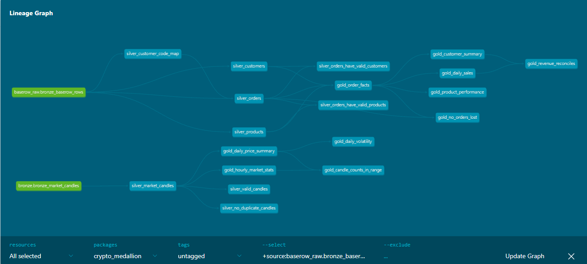
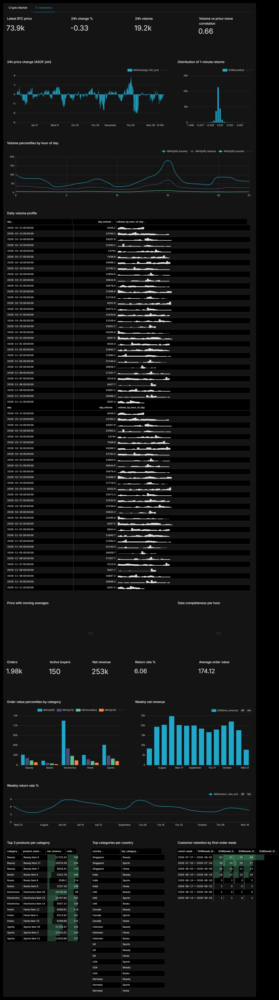

# Medallion Data Platform

An end-to-end data engineering project that ingests data from three sources into ClickHouse and transforms each with a Medallion Architecture (bronze, silver, gold). It also makes the pipeline trustworthy: data contracts are enforced at ingestion, bad records are quarantined instead of loaded, quality and freshness checks run from bronze to gold, and monitoring sends alerts before a dashboard goes wrong.

| Source | Ingestion | Orchestration | Domain |
|---|---|---|---|
| Binance klines API (history) | Python script | Airflow | Crypto market data |
| Binance klines API (live) | Apache NiFi | NiFi (every 60 seconds) | Crypto market data |
| Baserow REST API | Python script | Airflow | E-commerce (customers, products, orders) |

## Architecture

- **Apache NiFi:** Near-real-time ingestion. Polls the Binance klines API every 60 seconds, splits the response into candles, drops the still-forming one, and posts the rest to the ClickHouse landing table. Timeouts are retried, and permanent errors wait in a funnel queue.
- **Apache Airflow:** Four DAGs:
  - `crypto_medallion_pipeline` (02:00 UTC): load bronze, quality gate, dbt run, dbt test
  - `baserow_medallion_pipeline` (03:00 UTC): load bronze, quality gate, dbt run, dbt test
  - `pipeline_monitor` (every 5 minutes): run all checks and alert
  - `historical_crypto_ingestion`: manual batch load only
- **dbt:** Builds and tests silver and gold models (ELT inside ClickHouse), organized by source domain.
- **ClickHouse:** Stores landing, quarantine, bronze, silver and gold tables, plus the monitoring results.
- **Apache Superset:** Dashboards on silver, gold and pipeline health, using a read-only ClickHouse user.
- **Discord webhook:** Receives alerts (Slack webhooks work the same way).
- **Docker Compose:** Reproducible local environment.
- **GitHub Actions:** Continuous integration. Builds and tests all dbt models against a temporary ClickHouse on every push.

```
Binance REST API (history) -> Airflow + Python -> landing -> contract rules -> bronze | quarantine
Binance REST API (live)    -> NiFi              -> landing -> contract rules -> bronze | quarantine
Baserow REST API           -> Airflow + Python -> landing -> contract rules -> bronze | quarantine
bronze -> quality gate -> dbt -> silver -> dbt -> gold -> Superset
run_checks.py (every 5 min) -> pipeline_check_results -> Discord alerts + Superset health tab
```





## Data Contracts

One YAML file per source in `contracts/` describes what a valid record is and what the service levels are. The ingestion rules, the checks and the loaders read their thresholds from these files.

| Contract | Freshness warn / error | Minimum volume | Max reject rate (on breach) |
|---|---|---|---|
| `binance_klines_batch.yaml` | 26 h / 50 h | 40,000 rows per load | 1% (fail the run) |
| `binance_klines_live.yaml` | 5 min / 15 min | 50 candles per hour | 5% (alert) |
| `baserow_ecommerce.yaml` | 26 h / 50 h | 100 customers, 20 products, 1,500 orders | 3% (fail the run) |

Each contract also lists the field rules, the record rules and the warehouse checks, with a severity:
- **error:** the record is rejected, or the pipeline stops and alerts.
- **warn:** the record loads, is counted and is flagged.
- **info:** noted only, such as the overlapping live polls, which silver deduplicates.

## Ingestion Enforcement

Every source writes raw values into a landing table (ClickHouse `Null` engine, which stores nothing). Chained materialized views check each record against the contract:

- **Valid records** go to `bronze_market_candles` or `bronze_baserow_rows`.
- **Invalid records** go to `quarantine_market_candles` or `quarantine_baserow_rows`, with the list of rules they failed, kept for 90 days.

Candle rules: parsable positive prices, non-negative volume, high not below low, high and low covering open and close, a one-minute window, a minute-aligned open time, and a closed candle. Baserow rules: code formats, email format, allowed statuses (case-insensitive), quantity from 1 to 100, plausible dates, discount from 0 to 100, and positive prices.

The batch and Baserow loaders insert first and delete the previous load afterwards. If a load breaches its contract (reject rate or minimum rows), it removes what it just loaded, keeps the previous data and fails, so Airflow alerts. Rules that compare rows (duplicates, orders pointing at missing customers) cannot be checked one record at a time, so dbt tests and the monitoring checks cover them.

## Domain 1: Crypto Market Data

- Market: BTC/USDT, 1-minute candles. Batch history: rolling 30 days. Live: one poll per minute, closed candles only.
- **Bronze** (`bronze_market_candles`): validated candles from both sources, append-only, tagged `batch` or `nifi`. Overlapping polls can create duplicates here by design.
- **Silver** (`silver_market_candles`): sanity-checked, deduplicated to one row per `(symbol, interval, open_time)`, keeping the most recently ingested copy.
- **Gold:** `gold_daily_price_summary`, `gold_hourly_market_stats`, `gold_daily_volatility`, `gold_daily_volume_profile`.

## Domain 2: Baserow E-commerce

Three Baserow tables (`customers`, `products`, `orders`) hold mock data from `scripts/generate_baserow_mock_data.py`, with deliberate quality problems: duplicate customers with different email casing, missing countries, inconsistent status spelling and invalid quantities.

- **Bronze** (`bronze_baserow_rows`): every row as raw JSON. The 19 orders with invalid quantities are quarantined here and never loaded.
- **Silver:** `silver_customers`, `silver_customer_code_map`, `silver_products`, `silver_orders` (typed, cleaned, duplicates merged).
- **Gold:** `gold_order_facts`, `gold_daily_sales`, `gold_customer_summary`, `gold_product_performance`. Revenue counts only Delivered and Shipped orders.

## Quality Checks and Monitoring

- **35 dbt tests:** 13 for crypto, 22 for Baserow (keys, accepted values, referential checks, no lost orders, reconciliation of revenue).
- **21 monitoring checks** in `scripts/run_checks.py`, every result stored in `pipeline_check_results` and summarized in the view `pipeline_health_latest`:
  - Freshness (7): live and batch bronze, Baserow bronze, and the last build of four silver and gold tables
  - Volume (5): live candles per hour, batch rows, and rows per Baserow table
  - Quarantine rates (3): live, batch and Baserow
  - Reconciliation (4): bronze to silver to gold for candles and orders
  - Anomalies (2): one-minute price jumps above 2% (warn only, real crashes must not be rejected) and missing candle minutes
- **Quality gates:** before dbt runs, the daily DAGs run the bronze checks (row counts, reject rates, candle gaps). If one fails, dbt does not run, so silver, gold and the dashboard go stale instead of wrong.
- **Alerts** go to Discord only when a check changes state, plus a recovery message, so a long outage does not spam the channel. Airflow also alerts on every task retry and failure, and the monitor sends one alert if it cannot reach ClickHouse.
- **Superset health tab:** check status, live freshness trend, rejected records per hour and the reasons.

See `docs/runbook.md` for what each alert means and how to respond.

## Failure Rehearsal

| What was broken | What happened |
|---|---|
| NiFi stopped | Freshness warned at 5 minutes and errored at 15, both with Discord alerts, and recovered after restart |
| Four bad Baserow records sent through the landing table | All four quarantined with their rule names (`quantity_range`, `status_allowed`, `discount_range`, `email_format`), the valid record in the same insert loaded, and reconciliation warned until cleanup |
| Load breaching a stricter contract (reject limit 0.5%) | Loader rolled back, bronze stayed unchanged, retry and failure alerts sent, downstream tasks skipped |
| ClickHouse stopped | One alert on the outage and one on recovery |
| Broken dbt model | The broken model failed alone and the others built, so silver and gold stayed intact |
| Impossible candle (high below low) | Quarantined with the failed rule names and never reached bronze |
| Laptop off overnight, repeatedly | Freshness and gap errors on the next start, and recovery messages once the batch reload and NiFi caught up |
| DNS failure and ClickHouse memory limit (before alerting existed) | Airflow retried and failed visibly. These incidents are why task retry and failure alerts were added |

## Known Limitations

- If Docker or Airflow itself is down, nothing can send alerts. An external heartbeat service would cover this.
- NiFi's funnel queue (permanently rejected requests) is not monitored directly, only through the live volume and freshness checks.
- A deleted customer or product is caught by dbt tests only after gold has been rebuilt.
- The contract protects the ingestion path. Direct writes into bronze bypass it, and production would restrict bronze to the pipeline user.
- The live-volume check recovers slowly after an outage, because it counts candles collected in the last hour, and NiFi cannot backfill missed minutes (the daily batch does).
- The stack needs about 4 GB of Docker memory. Keep Superset stopped when not in use.
- Superset uses a local SQLite metadata database, and the data volumes live on one machine.
- The Running Locally steps were verified piece by piece on one machine, not from a clean machine. CI verifies table creation and the dbt models from an empty database.

## Dashboard (Apache Superset)

The **Medallion Warehouse Analytics** dashboard has three tabs (Crypto Market, E-commerce, Pipeline Health). Its charts use ClickHouse-specific functions:

- `exponentialTimeDecayedAvg` as a window function for moving averages
- `ASOF JOIN` for 24-hour price change
- `quantilesTDigest`, `histogram()`, `corr`, `argMax`/`argMin`
- `ORDER BY ... WITH FILL` to expose missing hours
- `sparkbar` (built in dbt as `gold_daily_volume_profile`, because Superset's SQL parser rejects parametric aggregates)
- `LIMIT n BY`, `topKWeighted`, `retention()`, and the `-If` combinators

Files: `superset/Dockerfile` (image with the `clickhouse-connect` driver), `superset/dashboard_queries.sql` (the SQL behind the datasets), `superset/dashboard_export/` (importable bundle).

Setup after `docker compose up -d`:

1. Initialize once: `docker exec -it medallion-superset superset db upgrade`, then `superset fab create-admin --username admin --firstname Admin --lastname User --email admin@example.com`, then `superset init`.
2. Create a read-only ClickHouse user: `CREATE USER superset_ro IDENTIFIED BY '<password>'` and `GRANT SELECT ON medallion_warehouse.* TO superset_ro`.
3. In Superset (http://localhost:8088), add a ClickHouse Connect database with host `clickhouse`, port `8123`, database `medallion_warehouse` and that user, then import the bundle from `superset/dashboard_export/`.

## CI/CD

- **CI:** `.github/workflows/dbt-ci.yml` starts a temporary ClickHouse, creates all tables from `clickhouse/init/`, loads synthetic crypto and Baserow data (deliberately messy), then runs `dbt run` and `dbt test`. A broken model or failing test turns the push red.
- **CD:** future work. The stack runs locally, so there is no deployment target.

## Project Structure

- `contracts/`: data contracts (one YAML per source)
- `nifi/flows/`: exported NiFi flow
- `airflow/dags/`: the four DAGs. `airflow/Dockerfile`: Airflow image with dbt in its own virtual environment
- `clickhouse/init/`: table DDL, run automatically on first start (bronze, ingestion contract, Baserow contract, monitoring)
- `dbt/`: models and tests, split into `crypto` and `baserow`
- `scripts/`: loaders, `run_checks.py`, `alert.py`, `make_nifi_insert_url.py`, mock data generator
- `scenarios/`: SQL used to inject bad records for the failure rehearsal
- `superset/`: dashboard image, queries and export
- `docs/`: architecture, runbook, screenshots
- `.github/workflows/`: CI

## Running Locally

1. Copy `.env.example` to `.env` and fill in the passwords (NiFi needs at least 12 characters), the Baserow token and table IDs, `SUPERSET_SECRET_KEY` and `ALERT_WEBHOOK_URL`.
2. Create a Discord (or Slack) webhook in a private channel and put its URL in `ALERT_WEBHOOK_URL`. Keep it out of the repository.
3. Baserow: create a database `ecommerce_demo`, run `python scripts/generate_baserow_mock_data.py`, and import the three CSV files from `data/baserow/` as tables `customers`, `products` and `orders`.
4. Build and start: `docker compose up -d --build`. The scripts in `clickhouse/init/` create all tables on first start.
5. NiFi (https://localhost:8443/nifi): import `nifi/flows/Binance_Live_Market_Ingestion.json`, set the ClickHouse password on the final InvokeHTTP processor, and start the group. `python scripts/make_nifi_insert_url.py` prints the URL for its HTTP URL property.
6. Airflow (http://localhost:8082): unpause the DAGs, then trigger `crypto_medallion_pipeline` and, after it finishes, `baserow_medallion_pipeline`. Unpause `pipeline_monitor` to start the checks.
7. Allow about an hour after NiFi starts before the live-volume check turns green.
8. Optional: set up Superset as described above.

## Status

- Crypto, live and Baserow ingestion, silver and gold models: done
- Superset dashboard with ClickHouse-specific analytics: done
- Data contracts, ingestion enforcement and quarantine: done
- Quality checks, monitoring, alerts and the health tab: done
- Failure rehearsal and runbook: done
- CI: done. CD: future work