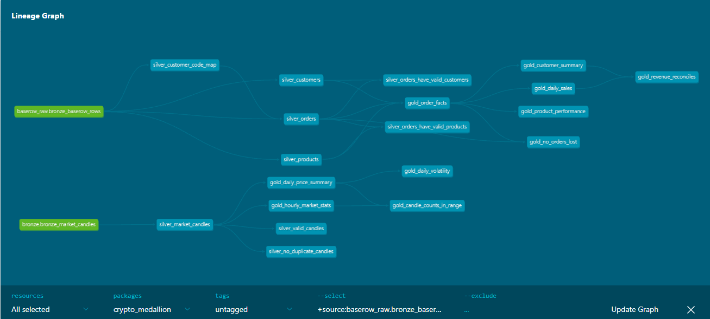

# Medallion Data Platform

An end-to-end data engineering project that ingests data from three sources into ClickHouse and transforms each of them with a Medallion Architecture (bronze, silver, gold). It started as a crypto market data pipeline and was extended with a Baserow e-commerce source.

| Source | Ingestion | Orchestration | Domain |
|---|---|---|---|
| Binance klines API (history) | Python script | Airflow | Crypto market data |
| Binance klines API (live) | Apache NiFi | NiFi (every 60 seconds) | Crypto market data |
| Baserow REST API | Python script | Airflow | E-commerce (customers, products, orders) |

## Architecture

- **Apache NiFi:** Near-real-time ingestion. Polls the Binance public klines REST API every 60 seconds, splits the response into individual candles, and inserts only closed candles into ClickHouse bronze. The forming candle is dropped so partial data never lands.
- **Apache Airflow:** Runs two daily pipelines, each loading bronze and then running and testing its dbt models:
  - `crypto_medallion_pipeline` (02:00 UTC)
  - `baserow_medallion_pipeline` (03:00 UTC)
  
  A separate `historical_crypto_ingestion` DAG loads only the crypto batch data and is triggered manually.
- **dbt:** Builds and tests silver and gold models (ELT inside ClickHouse), organized by source domain.
- **ClickHouse:** Stores bronze, silver, and gold analytical tables.
- **Docker Compose:** Provides a reproducible local environment.
- **GitHub Actions:** Continuous integration. Builds and tests all dbt models against a temporary ClickHouse on every push.

```
Binance REST API (history) -> Airflow + Python -> ClickHouse bronze (crypto)
Binance REST API (live)    -> NiFi              -> ClickHouse bronze (crypto)
Baserow REST API           -> Airflow + Python -> ClickHouse bronze (raw JSON)
ClickHouse bronze -> dbt -> silver -> dbt -> gold
```



## Domain 1: Crypto Market Data

- Market: BTC/USDT, 1-minute candles
- Batch history: rolling window of approximately 30 days
- Live: one poll per minute; closed candles only

**Bronze** (`bronze_market_candles`): Raw candles from both sources, append-only. Rows carry a `source` tag (`batch` or `nifi`) and an `ingested_at` timestamp. Overlapping live polls and batch/live overlap can create duplicate candles here by design.

**Silver** (`silver_market_candles`): Closed candles with sanity checks applied (positive prices, high >= low, non-negative volume), deduplicated to one row per `(symbol, interval, open_time)`, keeping the most recently ingested copy.

**Gold:**
- `gold_daily_price_summary`: daily open, high, low, close, volume, trades, price change and percent change, with a flag for complete days (1,440 candles).
- `gold_hourly_market_stats`: hourly OHLC, volume and trades, with a flag for complete hours (60 candles).
- `gold_daily_volatility`: daily high-low range as a percent of the open, a 7-day average range, and volume relative to the 7-day average (complete days only).

## Domain 2: Baserow E-commerce

Baserow holds three tables in a database named `ecommerce_demo`: `customers`, `products` and `orders`. The data is mock data generated by `scripts/generate_baserow_mock_data.py` (fixed random seed) and imported into Baserow as CSV. It contains deliberate quality problems for silver to clean: duplicate customers with different email casing, missing countries, inconsistent status spelling, and invalid quantities.

**Bronze** (`bronze_baserow_rows`): One generic table. Every Baserow row lands as raw JSON in `payload`, with `table_name`, Baserow's `row_id` and `extracted_at`. Each load replaces the rows of the table it reloads, so reruns never duplicate. All tables are fetched before anything is changed, so a failed API call never empties bronze.

**Silver:**
- `silver_customers`: parsed and typed, emails normalized, duplicate customers merged (lowest customer code kept), missing countries set to `Unknown`.
- `silver_customer_code_map`: maps every customer code to its canonical code, so orders placed under a duplicate customer are attributed to the original.
- `silver_products`: parsed and typed, invalid prices removed.
- `silver_orders`: parsed and typed, status spelling normalized, orders with a quantity of 0 or less removed, customer codes mapped to canonical codes.

**Gold:**
- `gold_order_facts`: one row per order, joined to customer and product, with gross and net amounts. Revenue counts only Delivered and Shipped orders.
- `gold_daily_sales`: orders, cancellations, returns, units, gross and net revenue and average order value per day.
- `gold_customer_summary`: orders, units, lifetime net revenue and first/last order date per customer.
- `gold_product_performance`: orders, units, net revenue, return rate and average discount per product.

## Data Quality

48 dbt tests in total, run with `dbt test`:

- **Crypto (13):** not-null checks on key columns, uniqueness of the daily volatility key, no duplicate candles in silver, valid price and volume values in silver, and sanity limits on candle counts per day and per hour in gold.
- **Baserow (22 + checks inside):** not-null and uniqueness on keys, accepted values for order status, every order points to an existing customer and product, no orders are lost between silver and the gold fact table, and daily revenue reconciles with per-customer revenue.

## Handling Gaps and Reruns

- The live NiFi flow only collects while it is running, so downtime leaves gaps. The daily crypto batch re-pulls the last 30 days and replaces its own `batch` rows without touching `nifi` rows. Silver deduplicates any overlap, so the batch reload heals gaps with no duplicates downstream.
- The Baserow loader replaces each table's bronze rows on every run, so reruns are safe.
- Both DAGs use `max_active_runs=1`, so two runs of the same DAG never overlap.

## CI/CD

- **CI (implemented):** The workflow in `.github/workflows/dbt-ci.yml` starts a temporary ClickHouse, creates the bronze tables from `clickhouse/init/`, loads synthetic crypto candles and synthetic Baserow rows (both deliberately messy), then runs `dbt run` and `dbt test` on the whole project. A broken model or failing test turns the push red.
- **CD (future work):** There is no server to deploy to, since the stack runs locally in Docker. With a target environment, a deploy job would run after CI passes on `main` and update the DAGs and dbt project there.

## Project Structure

- `nifi/flows/`: Exported NiFi flow definition (`Binance_Live_Market_Ingestion.json`).
- `airflow/dags/`: `crypto_medallion_pipeline.py`, `baserow_medallion_pipeline.py`, `historical_crypto_ingestion.py`.
- `airflow/Dockerfile`: Airflow image with dbt installed in its own virtual environment.
- `clickhouse/init/`: Bronze table DDL, run automatically on first start of an empty volume.
- `dbt/models/crypto/`: Crypto silver and gold models, source and schema files.
- `dbt/models/baserow/`: Baserow silver and gold models, source and schema files.
- `dbt/tests/crypto/`, `dbt/tests/baserow/`: Singular SQL tests per domain.
- `scripts/`: `load_historical_candles.py`, `load_baserow_tables.py`, `generate_baserow_mock_data.py`.
- `docs/`: Architecture documentation and the dbt lineage screenshot.
- `.github/workflows/`: CI workflow.

## Running Locally

1. Copy `.env.example` to `.env` and set the passwords. NiFi requires a password of at least 12 characters.
2. Baserow setup: create a Baserow account and a database named `ecommerce_demo`. Run `python scripts/generate_baserow_mock_data.py`, then import the three CSV files from `data/baserow/` as tables named `customers`, `products` and `orders`. Create a read-only database token and put it in `.env` together with the three table IDs (`BASEROW_TOKEN`, `BASEROW_CUSTOMERS_TABLE_ID`, `BASEROW_PRODUCTS_TABLE_ID`, `BASEROW_ORDERS_TABLE_ID`).
3. Build and start the services: `docker compose up -d --build`
4. Import `nifi/flows/Binance_Live_Market_Ingestion.json` into NiFi (https://localhost:8443/nifi), set the ClickHouse password on the final InvokeHTTP processor, and start the process group.
5. In Airflow (http://localhost:8082), unpause and trigger `crypto_medallion_pipeline`, wait for it to finish, then trigger `baserow_medallion_pipeline`. Each loads its bronze data, then builds and tests its silver and gold models.
6. Optional, to run dbt from your own machine: `pip install dbt-core dbt-clickhouse`, then from the `dbt/` folder, with `CLICKHOUSE_PASSWORD` set as an environment variable, run `dbt run --profiles-dir .` and `dbt test --profiles-dir .`

## Status

- Crypto batch ingestion (Airflow): done
- Crypto live ingestion (NiFi): done
- Baserow ingestion (Airflow): done
- Silver and gold dbt models for both domains: done
- dbt tests and lineage docs: done
- dbt scheduled through Airflow for both domains: done
- CI with GitHub Actions: done
- CD: future work